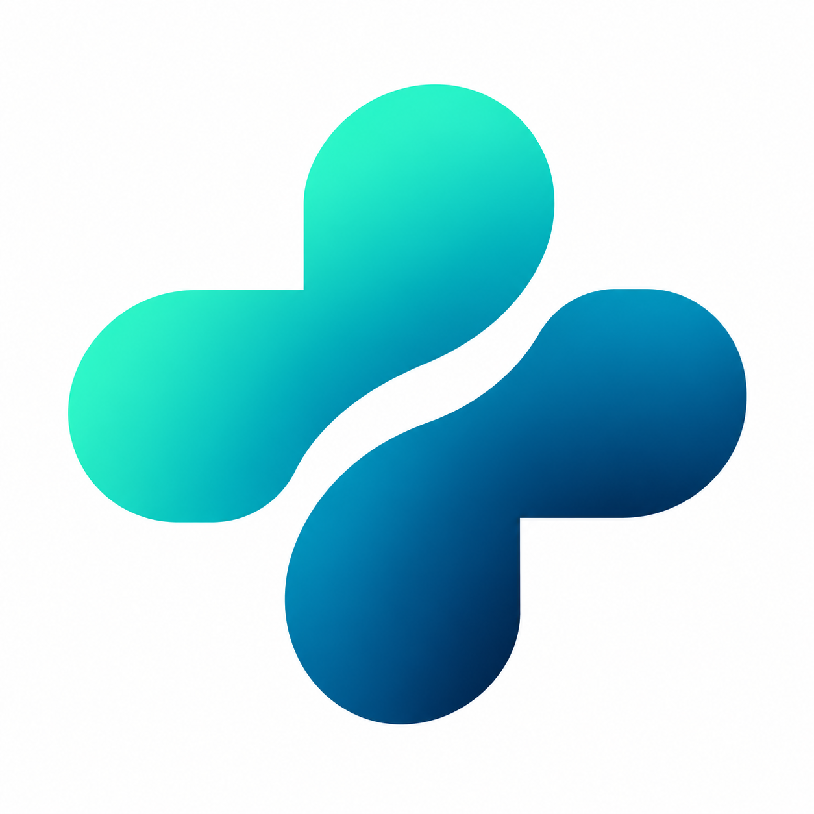

  

<h1 align="center">Clinexa One</h1>

  Gestión de consultorio médico, simple y sin internet obligatorio. 
  Agenda, historias clínicas, récipes, cobros, gastos e insumos en una sola app.

  <a href="https://github.com/Miguelvillegassc/clinexa-releases/releases/latest"><b>⬇ Descargar la última versión</b></a>

---

## ¿Qué hace?

### 📅 Agenda
- Citas del día y de la semana, con estado: pendiente, atendida, no vino o cancelada.
- Recordatorio por **WhatsApp** a los pacientes con cita mañana, uno por uno.

### 🩺 Pacientes e historia clínica
- Ficha del paciente: edad, sexo, tipo de sangre, **alergias** (siempre visibles al atender) y antecedentes.
- Consultas con motivo, evolución y examen físico, diagnóstico e indicaciones.
- **Estudios y resultados adjuntos**: rayos X, laboratorio, ecografías, informes (imágenes o PDF).
- **Próximo control**: si llega la fecha y el paciente no tiene cita, la app te avisa en Inicio.

### 📄 Documentos listos para imprimir
- **Récipe** con medicamentos e indicaciones, con el encabezado y los datos del médico.
- **Orden de exámenes**.
- **Constancia de reposo médico** con las fechas calculadas.

### 💵 Cobros
- Cada consulta puede registrar su cobro: pagado al momento o pendiente.
- Montos en dólares con su equivalente en **bolívares** a tasa **BCV (dólar o euro)** para pago móvil y transferencia.
- Tasas del día actualizadas automáticamente (BCV y USDT P2P), y se guardan para verlas sin conexión.
- Cuentas por cobrar con abonos parciales y lista de pacientes que deben.

### 📊 Gastos
- Alquiler, servicios, sueldos y demás, para ver la **ganancia real** del consultorio.

### 📦 Insumos
- Inventario de medicamentos y material, con entradas, salidas y ajustes.
- Alertas de **stock bajo** y **agotado**.

### ⚙️ Y además
- **Funciona sin internet**: los datos se guardan en el equipo, no en la nube.
- **Respaldo automático diario** en `Documentos › Clinexa respaldos`.
- Usuarios con contraseña y registro de actividad (quién anuló o cambió qué).
- Tema claro, oscuro o automático, varios colores de marca y tamaño de texto ajustable.
- **Se actualiza sola**: al abrir, si hay una versión nueva, la instala y se reinicia. Tus datos no se tocan.

---

## Instalación

Entra a **[la última versión](https://github.com/Miguelvillegassc/clinexa-releases/releases/latest)** y descarga el archivo de tu sistema:

| Sistema | Archivo |
|---|---|
| **Windows** 10 / 11 | `Clinexa_x.y.z_x64-setup.exe` |
| **Mac** (Intel y Apple Silicon) | `Clinexa_x.y.z_universal.dmg` |
| **Linux** | `.AppImage` (cualquier distro), `.deb` (Ubuntu / Debian) o `.rpm` (Fedora) |

> Los archivos `.sig`, `.tar.gz` y `latest.json` los usa la app para actualizarse; no hace falta descargarlos.

### Avisos al instalar por primera vez

La app todavía no está firmada con un certificado comercial, así que el sistema puede advertir que es de un desarrollador desconocido:

- **Windows**: si aparece "Windows protegió su PC", toca **Más información → Ejecutar de todas formas**.
- **Mac**: si dice que no se puede abrir, haz **clic derecho sobre la app → Abrir → Abrir**. Solo la primera vez.
- **Linux (AppImage)**: dale permiso de ejecución (`chmod +x Clinexa_*.AppImage`) y ábrela.

---

## Tus datos

- Todo queda guardado **solo en tu computadora**. Nada se envía a ningún servidor.
- La app solo se conecta a internet para consultar las tasas del día y buscar actualizaciones.
- Cada computadora tiene su propia base de datos. Para pasar los datos a otro equipo, copia el respaldo más reciente de `Documentos › Clinexa respaldos`.

---

Este repositorio solo publica los instaladores de Clinexa One.

